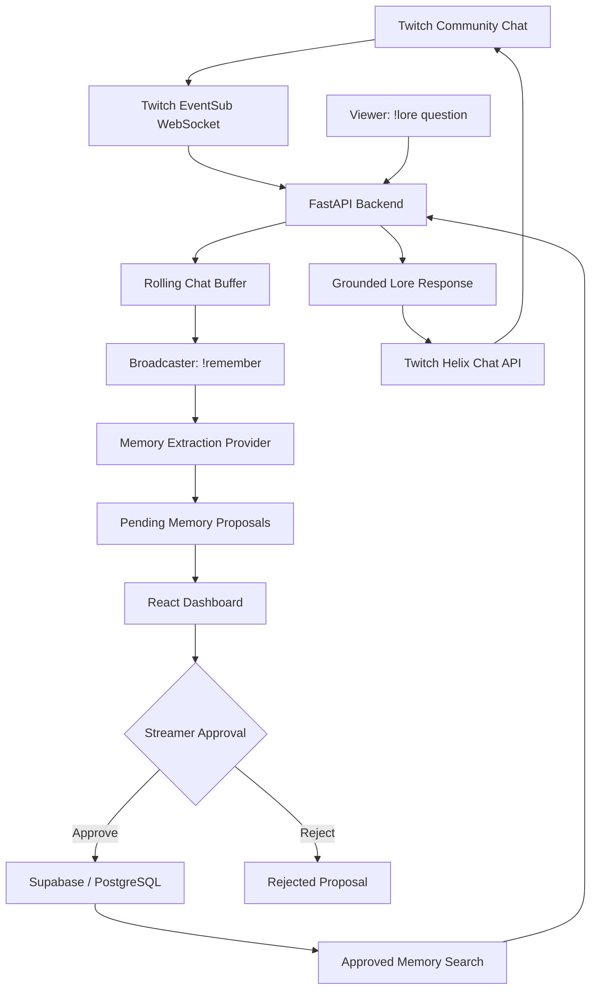

# 🧠 Stream Memory

### Every Twitch community has a story. Stream Memory makes sure it never gets lost.

Stream Memory is an AI-powered memory layer for Twitch communities. It transforms meaningful live chat moments, inside jokes, recurring characters, and community events into persistent, streamer-approved memories that viewers can explore using natural language.

Instead of letting great community moments disappear in chat history, Stream Memory turns them into searchable community lore.

---

## ✨ Features

- **Live Twitch Chat Integration:** Receives channel chat messages through Twitch EventSub WebSockets.
- **Context-Aware Memory Capture:** Maintains a broadcaster-specific rolling chat buffer and captures relevant context when the broadcaster uses `!remember`.
- **AI-Assisted Memory Extraction:** Converts chat evidence into structured memory proposals.
- **Streamer-Controlled Moderation:** Review, edit, approve, reject, or delete proposed memories before they become permanent lore.
- **Persistent Community Memory:** Stores approved memories and their supporting sources in Supabase.
- **Natural Language Lore Search:** Viewers can use `!lore <question>` to retrieve relevant community memories.
- **Grounded Responses:** Lore answers are based on approved memories rather than unrestricted chat history.
- **Community Isolation:** Searches are scoped to the broadcaster's community.
- **React Dashboard:** Manage pending memory proposals and explore approved community lore.

## 🎬 How It Works

Stream Memory follows a simple principle:

**Chat → Capture → Extract → Approve → Remember → Retrieve**

1. **Chat:** Twitch messages arrive through EventSub.
2. **Capture:** A broadcaster triggers `!remember <topic>` to capture relevant recent chat context.
3. **Extract:** The extraction provider identifies potential community memories and creates structured proposals.
4. **Approve:** The streamer reviews and approves or rejects proposals through the dashboard.
5. **Remember:** Approved memories and their supporting sources are persisted in Supabase.
6. **Retrieve:** Viewers ask questions using `!lore <question>`, and the system searches approved memories to generate an evidence-grounded response.

## 🏗️ Architecture



## 🛠️ Tech Stack

| Layer | Technologies |
|---|---|
| Backend | Python, FastAPI, Pydantic |
| Frontend | React, Vite, JavaScript |
| Database | Supabase, PostgreSQL |
| Authentication | Twitch OAuth 2.0 |
| Chat Integration | Twitch EventSub, Helix API |
| AI Integration | OpenAI Responses API, provider abstraction |
| Testing | Pytest |

## 📁 Project Structure

```text
stream-memory/
│
├── backend/
│   ├── app/
│   │   ├── config.py
│   │   ├── database/
│   │   ├── routes/
│   │   └── services/
│   ├── sql/
│   ├── tests/
│   └── requirements.txt
│
├── frontend/
│   └── src/
│
├── docs/
│   └── PRD.md
│
├── .env.example
├── .gitignore
├── AGENTS.md
├── pytest.ini
└── README.md
```

## 🚀 Getting Started

### Prerequisites

- Python 3.11 or newer
- Node.js LTS and npm
- A Supabase project
- A Twitch Developer application

### 1. Clone the repository

```bash
git clone https://github.com/dheemanthjnirvani2005-arch/stream-memory.git
cd stream-memory
```

### 2. Set up the backend

Create and activate a virtual environment:

```powershell
py -3.11 -m venv .venv
.\.venv\Scripts\Activate.ps1
```

Install dependencies:

```powershell
python -m pip install --upgrade pip
pip install -r backend\requirements.txt
```

### 3. Configure environment variables

Copy the example configuration:

```powershell
Copy-Item .env.example backend\.env
```

Configure the required values in `backend/.env`.

Keep credentials private. Never commit environment files or expose backend secrets to the frontend.

For local development, use:

```env
AI_PROVIDER=mock
APP_ENV=development
```

The mock provider supports deterministic development and testing without requiring paid API calls. Configure the real AI provider separately when you want to test actual model inference.

Generate secure local secrets:

```powershell
python -c "import secrets; print(secrets.token_urlsafe(32))"
```

For the token encryption key:

```powershell
python -c "from cryptography.fernet import Fernet; print(Fernet.generate_key().decode())"
```

### 4. Configure Supabase

1. Create a Supabase project.
2. Configure `SUPABASE_URL` and `SUPABASE_SECRET_KEY` in `backend/.env`.
3. Apply the SQL migrations in the following order:

```text
001_initial_schema.sql
002_twitch_credentials.sql
003_memory_workflow.sql
004_approved_memory_search.sql
```

Apply only missing migrations after checking the existing database schema.

The Supabase secret key must remain exclusively on the backend.

### 5. Configure Twitch OAuth

1. Create an application in the [Twitch Developer Console](https://dev.twitch.tv/console/apps).
2. Configure the OAuth redirect URI:

```text
http://localhost:8000/auth/twitch/callback
```

3. Add the following configuration to `backend/.env`:

```env
TWITCH_CLIENT_ID=
TWITCH_CLIENT_SECRET=
TWITCH_REDIRECT_URI=http://localhost:8000/auth/twitch/callback
```

4. Configure the session secret and token encryption key.
5. Start the backend and visit:

```text
http://localhost:8000/auth/twitch/login
```

6. Authorize the broadcaster account that owns the test channel.

The application uses broadcaster-authorized Twitch credentials for chat integration.

### 6. Run the backend

From the repository root:

```powershell
cd backend
uvicorn app.main:app --reload --host 127.0.0.1 --port 8000
```

Backend API documentation:

```text
http://localhost:8000/docs
```

Health endpoint:

```text
http://localhost:8000/health
```

### 7. Run the frontend

Open another terminal:

```powershell
cd frontend
npm install
npm run dev
```

Open:

```text
http://localhost:5173
```

## 💬 Twitch Commands

### Capture a memory

The broadcaster sends:

```text
!remember Kevin
```

Stream Memory captures relevant recent chat context and generates a pending memory proposal.

### Query community lore

A viewer sends:

```text
!lore Who is Kevin?
```

The backend searches approved memories belonging to that broadcaster's community and responds through the Twitch chat API.

If no relevant approved memory is available, the system uses its no-memory response rather than inventing community history.

## 🧪 Testing

Run backend tests from the repository root:

```powershell
$env:PYTHONPATH = "backend"
pytest backend/tests
```

Run frontend tests:

```powershell
cd frontend
npm test
```

The mock providers allow development and automated tests without depending on paid AI API calls.

## 🔐 Security and Design Principles

- Broadcaster-specific memory isolation.
- Streamer approval before memories become permanent.
- Supporting source evidence associated with memory proposals.
- Backend-only storage of Twitch and Supabase secrets.
- Encrypted Twitch credentials.
- Signed HTTP-only session cookies.
- Approved-memory-only retrieval.
- No unrestricted answers from unverified chat history.

## 🗺️ Roadmap

- [ ] Improve memory ranking and retrieval relevance.
- [ ] Add richer memory categories and relationships.
- [ ] Introduce memory timelines and community milestones.
- [ ] Improve dashboard analytics and moderation workflows.
- [ ] Add more robust EventSub reconnect and duplicate-event handling.
- [ ] Expand support for larger Twitch communities.

## 🎯 Motivation

Twitch communities develop their own personalities, traditions, inside jokes, and histories. But most of that context disappears as chat moves forward.

Stream Memory explores how AI can help preserve that history while keeping the community and streamer in control of what becomes permanent.

**The goal isn't just to remember messages. It's to remember what makes a community unique.**

---

## 👨‍💻 Author

**Dheemanth J Nirvani**

GitHub: [@dheemanthjnirvani2005-arch](https://github.com/dheemanthjnirvani2005-arch)

---

*Built for Twitch communities, with streamer-controlled AI memory.*